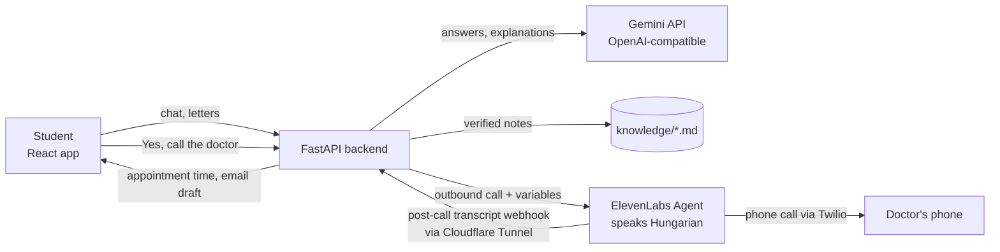

# Sera: autonomous campus concierge for international students

**Sera helps international students in Debrecen get things done in Hungarian: it answers their questions in English or Hungarian, explains official letters, and, with their permission, calls the campus doctor in Hungarian to book an appointment.**

**Track:** Autonomous Agents and Intelligent Systems
**Event:** GDG unideb Hackathon 2026

---

## The problem

Thousands of international students in Debrecen deal with Hungarian-only administration: doctors' receptionists, immigration letters, Neptun, landlords. A sick student with a fever who doesn't speak Hungarian can't easily phone the doctor, misses class, and doesn't know who to tell.

## What Sera does

| Feature | What the student sees |
|---|---|
| **Live demo: the agent acts** | The student writes *"I woke up sick with a high fever, I'm allergic to penicillin, and I can't attend my class today."* Sera extracts the symptoms and allergy and **asks permission**. Only after a yes does it phone the doctor (a real phone call, in Hungarian, via ElevenLabs + Twilio), and then shows the confirmed appointment time and prepares a bilingual absence email for the lecturer. |
| **Ask Sera** | Chat in English or Hungarian about healthcare, university (Neptun, student card), immigration and translation. Answers use a small verified knowledge base with sources. |
| **Proactive buttons** | Under each answer: *Open in email app* (Hungarian draft pre-filled), *Call 112*, *Show on map*, *Open official website*, *Copy Hungarian text*. Nothing is sent automatically. |
| **Explain a letter** | Paste or upload a Hungarian letter: Sera explains what it is, the dates and deadlines, and what to do. ID and passport numbers are hidden. |
| **Listen** | Any answer can be read aloud (ElevenLabs voice). |
| **Student workspace** (extra) | Documents, missions, deadlines and a rule-based risk check ("your passport expires before the permit renewal needs it"), with a "what if" simulator. |

Design rules we followed: **the student approves every external action**, failures are shown as failures (never "sent" when it wasn't), and facts, dates and deadlines come from code or verified notes, not from the AI's imagination.

## How it works



1. **Triage** (`POST /api/chat-triage`): fast rule-based extraction of name, symptoms (EN + HU), allergies and course. Emergencies are redirected to 112.
2. **Permission → call** (`POST /api/confirm-and-execute`): ElevenLabs outbound call with `student_name`, `symptoms`, `allergies` and `preferred_window` as dynamic variables.
3. **After the call** (`POST /api/elevenlabs-webhook`): reads the confirmed time (agent data collection, or Hungarian phrases like "fél három" from the transcript), then completes the mission. The UI polls `GET /api/mission-status`.
4. **Fallback** (`POST /api/simulate-call-complete`): finishes step 3 manually if the venue has no signal. It is labelled as manual on screen.

## Run it

Requirements: Python 3.11+, Node.js 20+.

```bash
# 1. Backend (port 8000)
python -m venv .venv
.venv/Scripts/pip install -r backend/requirements.txt        # macOS/Linux: .venv/bin/pip
cp backend/.env.example backend/.env                          # fill in the keys (see below)
.venv/Scripts/python -m uvicorn app.main:app --app-dir backend --host 0.0.0.0 --port 8000

# 2. Frontend (port 5173), in a second terminal
npm --prefix frontend install
cp frontend/.env.example frontend/.env
npm --prefix frontend run dev

# 3. Public URL for the ElevenLabs webhook (only needed for real calls), third terminal
cloudflared tunnel --url http://localhost:8000
# paste <printed URL>/api/elevenlabs-webhook into ElevenLabs → Post-call webhooks
```

Open http://localhost:5173 and go to **Live demo**. API docs: http://localhost:8000/docs.

**Without any keys** the app still runs: the chat answers in mock mode and the live demo can be finished with the fallback button.

Main settings in `backend/.env` (never commit this file):

| Variable | Used for |
|---|---|
| `OPENAI_API_KEY`, `OPENAI_BASE_URL`, `OPENAI_MODEL`, `OPENAI_FALLBACK_MODELS` | AI answers. We use Google Gemini through its OpenAI-compatible endpoint (free tier). |
| `ELEVENLABS_API_KEY`, `ELEVENLABS_AGENT_ID`, `ELEVENLABS_AGENT_PHONE_NUMBER_ID` | The Hungarian phone call. |
| `ELEVENLABS_VOICE_ID` | The "Listen" button. |
| `LECTURER_EMAIL`, optional `SMTP_EMAIL` + `SMTP_APP_PASSWORD` | Absence email. Without SMTP, the email is prepared and shown, marked "demo: not actually sent". |

Tests: `.venv/Scripts/python -m pytest backend -q` (67 tests; no keys or network needed).

## Tools, APIs, templates and AI assistants we used

As the rules ask, here is everything we used:

- **APIs:** Google **Gemini API** (via its OpenAI-compatible endpoint), **ElevenLabs** Conversational AI agents + text-to-speech, **Twilio** (phone number, connected through ElevenLabs), Google Maps search links (no API key).
- **Frameworks and libraries:** FastAPI, Pydantic, httpx, pypdf (backend); React, TypeScript, Vite, lucide-react icons (frontend).
- **Infrastructure:** Cloudflare Tunnel (`cloudflared`) to receive the post-call webhook on a laptop.
- **Starting point / template:** the frontend UI started from the repository [chriscodes404/Sera](https://github.com/chriscodes404/Sera) and was then connected to this backend and extended (Ask Sera, Live demo, Document Help, action buttons, voice).
- **AI assistants:** **Claude Code** (Anthropic) wrote most of the backend, the frontend changes and the tests together with the team. **ChatGPT** was used for planning and splitting the work. The ElevenLabs agent prompt was written by the team.
- **Knowledge base:** `backend/knowledge/*.md`, researched from university and official pages (sources listed in each file). Facts were collected with AI-assisted web search and should be double-checked before real use.

## Project structure

```
backend/
  app/main.py         API routes (chat, explain, speak, students, missions, impact, approvals)
  app/mission.py      Live demo: triage, outbound call, webhook, email
  app/assistant.py    Sera chat + document explanation (Gemini/OpenAI-compatible, fallback models)
  app/actions.py      Proactive buttons found in answers (email, call, map, link, copy)
  app/impact.py       Rule-based risk engine
  knowledge/          Verified notes used by the AI + 10 test questions
  scripts/check_answers.py   Runs the test questions against the live AI
  tests/              67 tests
frontend/src/
  pages/LiveDemoPage.tsx   Stage screen
  pages/AssistantPage.tsx  Ask Sera
  components/              Logo, action buttons, document help, voice widget
FRONTEND.md           API contract for the frontend
```

`main.py`, `prompts.py` and `studentmate-backend.zip` in the root are the first chatbot prototype, kept for reference.

## Limitations (honest list)

- Demo data only: one fictional student, data kept in memory, no login.
- The real call needs ElevenLabs/Twilio credits and a public webhook URL; the free Cloudflare URL changes on every restart.
- No OCR for photos of letters yet: students paste the text instead.
- The knowledge base is small (healthcare, immigration, University of Debrecen) and must be checked against official sources before real use.
- Sera is not a lawyer or a doctor, and it tells the student so.

## Next steps

Real student accounts and storage, OCR for letters, more universities and cities, calendar integration for appointments, and a reviewed knowledge base maintained with the university's international office.
